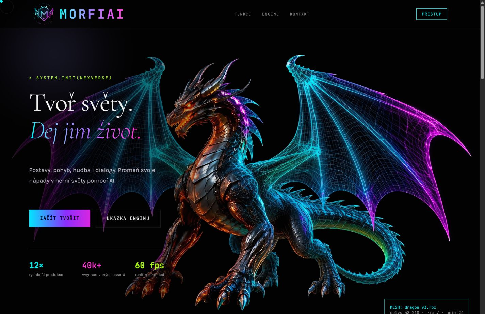
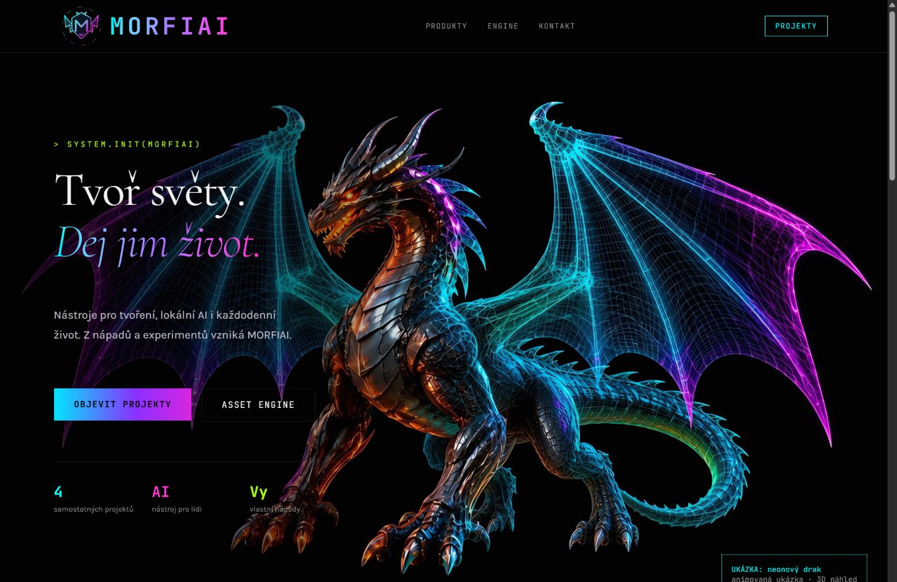
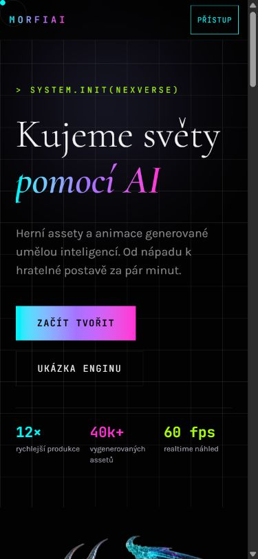
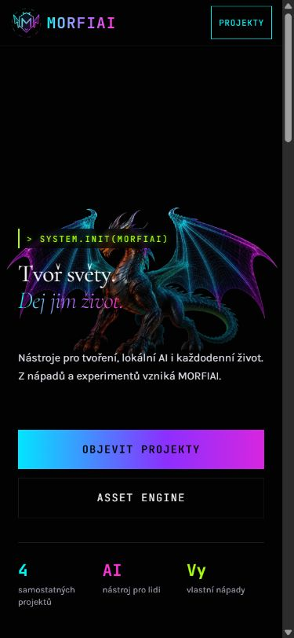
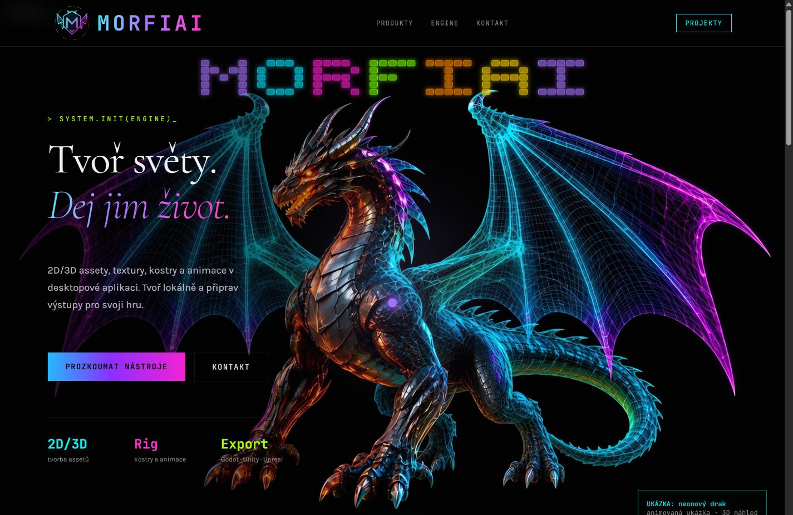

# MORFIAI — rozšíření původního webu, 1. 11. 2026

## Zdroj a bezpečnost nasazení

- Skutečná produkce: `nexversemino/nexversemino.github.io`, GitHub Pages `legacy`, větev `main`, kořen `/`, vlastní doména `morfiai.eu`.
- Výchozí produkční commit: `9dd6b7d442725ee67b653fb20784654fa382d146`.
- `nexversemino/morfiai` není aktuálním zdrojem Pages pro tuto doménu.
- Původní autorský React/TanStack zdroj: `nexversemino/cesky-drak-webove-krasy`, commit `fc39951cf18d1643afde79d003d5a375d0123b17`. Je starší než některé živé úpravy videa, maskota a Arkanoidu. Nebyl použit jako náhrada schváleného vzhledu.
- Pracovní větev: `content/morfiai-products-20261101`. Žádný push do produkční větve, změna domény, Pages nastavení, publikace ani merge.
- Při závěrečné kontrole se živé HTML **bajtově shodovalo** s původním Git blobem. SHA-256: `75ede378381ea5e21881e887081e32a87c8753cc7fee589ea3e49eb12345a5d7`. Doklad: `evidence/production-unchanged.json`.
- Původní obrázky, videa, GLB, logo, všechny původní CSS a `CNAME` zůstaly obsahově beze změny; ověřuje to regresní test. Původní soubory nebyly odstraňovány.

## Struktura a přesunuté sekce

| Původní část | MORFIAI `/` | `/engine/` |
|---|---|---|
| Úvodní obrazovka s drakem | Stejné hero, titulní slogan, obraz, písmo, animace a rozložení. Nový popis zastřešující značky. | Stejná společná komponenta; text Asset Enginu. |
| Funkce, původní karty | Přehled čtyř veřejně představovaných produktů a blogu. | Původní markup karet, Reveal, Tilt, TypedTitle a barevné varianty. Devět témat podle zadání: 2D/3D, textury, rigging, retargeting, timeline/pózy, knihovna, orchestrátor, export, lokální hardware. |
| Interaktivní GLB draka | Zachovaná skutečná implementace a skutečný GLB. | Tatáž implementace, společné assety a původní ovládání. |
| Rozdělená sekce „Animační engine“ | Filozofie Hrát si → Tvořit → Zprovoznit → Usnadnit život → Dát příležitost ostatním. | Původní rozložení „Pohyb, který žije“, konkrétní postup přípravy modelu pro hru. |
| Kontakt a maskot | Stejný layout a mailový kontakt, upravené texty. | Společné komponenty a původní návaznost průvodce na kontakt. |

Původní neověřené marketingové přísliby o časech generování, univerzálním výsledku, konkrétních počtech produkčních assetů nebo automatickém porozumění emocím se nově neslibují. Nejde o nové produktové funkce. Tato práce testuje prezentační web, nikoli všechny schopnosti desktopových produktů.

Nové adresy `/command-center/`, `/milo/`, `/laya/`, `/blog/` používají stejnou hlavičku, hero, karty, styly a patičku. MILO je označené jako vývoj/testování; Laya má jasně označený prostor pro budoucí ukázku bez falešného spuštění nebo stažení. Základ Command Center je popsaný jako budoucí bezplatná verze.

Podle navazujícího upřesnění je MinoBuddy pouze příběhem a výzvou pro partnery na `/blog/#pribeh`. Samotná platforma nemá odkaz, spuštění, registraci ani zákaznické/dětské účty na tomto webu. Příběh vysvětluje bezpečnost, odborné posouzení a infrastrukturu potřebné ke spuštění.

## Jeden skutečný míček

Na výslovné doplnění zadání používá Arkanoid **přímo původní ScrollOrb**, `#morfiai-guide-ball`:

1. Nahoře vlastní transformaci míčku Arkanoid.
2. Po odrolování o více než 2 pixely se hra pozastaví a vrátí průvodci aktuální pozici.
3. Původní průvodce dál sleduje `data-orb`, karty, nadpisy a kontakt.
4. Po návratu na začátek si stejný prvek opět převezme hra a pokračuje.

Žádný náhradní herní míček se nevytváří. Původní tečka kurzoru je během hry skrytá. ScrollOrb nepočítá vlastní pohyb v době, kdy prvek vlastní hra. Obě strany si tedy nepřepisují transformaci v jednom snímku.

Ve skutečném prohlížeči prošlo `top → down → top`: počet prvků byl pokaždé **1**, ID instance zůstalo stejné, vlastník se změnil `arkanoid → guide → arkanoid`. Viz `evidence/ball-handoff.json` a snímky `micek-arkanoid.jpg`, `micek-pruvodce.jpg`. Všechny dekorativní vrstvy měly `pointer-events: none`.

## Technické výsledky

- `npm run build`: úspěch; původní React komponenty a statické stránky se sestaví.
- `npm test`: **8/8 úspěšných testů**, log v `evidence/tests.txt`.
- Testuje se existence šesti skutečných stránek, všechny místní odkazy/kotvy/assety, jednotná hlavička, původní designové a binární soubory, opakovatelnost sestavení, absence falešných formulářů/účtů, příběh bez odkazu na dětskou platformu a skutečný modul Arkanoidu.
- Regrese Arkanoidu spouští jeho reálný JS modul v deterministickém testovacím DOM: předání stejného prvku, jednorázové předání pozice, návrat nahoře, přímé otevření dole, omezený pohyb a pozdní připojení původního průvodce bez vytvoření kopie.
- HTTP náhled: `/`, `/engine`, `/engine/`, `/command-center/`, `/milo/`, `/laya/`, `/blog/` všechny končí **200**. `/engine` přesměruje na vlastní `/engine/`, nikoli na titulní stránku. Viz `evidence/http-results.json`.
- Skutečné kliknutí v navigaci, obnovení `/engine/`, mobilní menu a otevření MILO i příběhu byly vyzkoušeny v prohlížeči.
- GLB v prohlížeči dosáhl skutečného stavu `nex-glb-loaded`. Fonty hlásily `loaded`. Opraven souběžný import dvou kopií model-vieweru; druhý CDN zdroj se používá až jako záloha.
- Responzivita všech šesti stránek prošla při CSS šířce **320 a 390 px**, bez vodorovného přetékání dokumentu; data v `evidence/responsive.json`.
- V lokálním přípravku simulujícím požadavek na omezený pohyb nevznikl průvodce ani Arkanoid, video nemělo autoplay a model neměl auto-rotate. Tato simulace a unit test nenahrazují fyzické přepnutí nastavení operačního systému, které se uživateli neměnilo. Odpovídající CSS `prefers-reduced-motion` je součástí implementace.
- Produkční deploy nových cest nebyl proveden. Jejich obsluha byla ověřena jako skutečné adresářové HTML v lokálním statickém náhledu odpovídajícím Pages. Kontrolu na veřejné doméně lze dokončit až po schváleném nasazení.

## Vizuální porovnání

Před změnami byly zachyceny screenshoty skutečného `https://morfiai.eu/` v desktopovém a mobilním zobrazení. Pro srovnání stejného stavu animací se navíc zachytil původní Git markup a nový výstup v lokálním přípravku `?capture=1`: stejné CSS rozlišení **1440 × 1000** / **390 × 844**, stejný zastavený poster videa, zastavené dekorativní animace a viditelný obsah. Přípravek není součástí veřejných HTML stránek a neovlivňuje běžné návštěvníky.

- Sedm porovnaných prvků (hlavička, H1, hero popis, nadpis sekce, karta, nadpis karty, tělo) má **49/49 shodných načtených hodnot** písma, velikosti, řádkování, barev, pozadí, odsazení a rámečků. Viz oba soubory `*-styles.json`.
- Snímky původní a nové titulní stránky byly skutečně otevřeny a vizuálně zkontrolovány. Desktopové JPEG výstupy mají shodné rozměry 1425 × 926 px; jde o zachycenou obsahovou plochu při uvedeném CSS viewportu.
- Po vyloučení oblastí záměrně změněných textů/navigace a pohyblivé záře bylo porovnáno **885 300 pixelů**. Rozdíl nad práh 15/255 má **0,056 % porovnávaných pixelů**. Průměrná odchylka kanálu je **0,064/255**. Toto číslo se vztahuje pouze k uvedené masce a stavu animací, nikoli k celému webu. Viz `evidence/visual-diff.json` včetně přesných vyloučených obdélníků.
- Navíc byla přímo zkontrolována mobilní titulní stránka, otevřené menu, příběh a běžící náhled Enginu s drakem.

| Původní titulní stránka | Upravená titulní stránka |
|---|---|
|  |  |
|  |  |

## Změněné soubory a návrat

Úplný seznam: [ZMENE-SOUBORY.txt](ZMENE-SOUBORY.txt). Obsah tvoří společné šablony, obsah, zapojení původních interakcí, generovaná HTML a potřebné testy/doklady. Žádné původní CSS, obrázky, video, GLB ani logo se nepřepisovaly.

Produkcí nadále zůstává původní `main`. Pro okamžitý návrat při kontrole stačí přejít z pracovní větve na `main`; pracovní větev není nasazená. Pokud se změna někdy schválí a sloučí, standardní návrat je reverzní commit změny, bez přepisování historie a bez mazání původních assetů.
